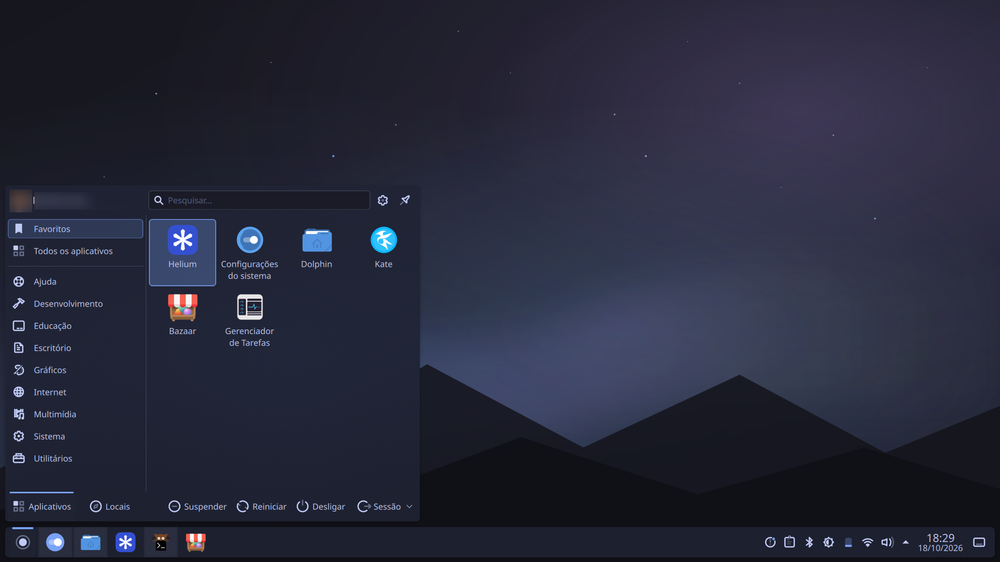

# Nocturne — Tema Global para KDE Plasma 6

Um tema escuro, inspirado no macOS, para o **KDE Plasma 6** (testado no Plasma 6.7
sob Wayland). Paleta baseada em **Tokyo Night** + **Catppuccin**, com painéis
translúcidos, blur, cantos arredondados e uma decoração de janelas Aurorae
customizada com botões monocromáticos integrados.



## O que está incluído

| Componente | Descrição |
|---|---|
| **Color scheme** | Esquema de cores escuro `Nocturne.colors` |
| **Plasma desktop theme** | Painéis/popups translúcidos com blur (`Nocturne`) |
| **Aurorae decoration** | Decoração de janelas com cantos arredondados, botões à direita e ícone à esquerda |
| **Global Theme (look-and-feel)** | Pacote que amarra as peças acima num tema único (preserva o layout de painéis) |
| **GTK overrides** | `gtk.css` (GTK3 e GTK4/libadwaita) para integrar apps GTK à paleta |

### Paleta

| Papel | Cor |
|---|---|
| Fundo base | `#1a1b26` |
| Fundo de janela | `#1f2235` |
| Superfície / cartões | `#24283b` |
| Texto | `#c0caf5` |
| Accent (azul) | `#7aa2f7` |
| Roxo | `#bb9af7` |
| Verde | `#9ece6a` |
| Vermelho | `#f7768e` |
| Amarelo | `#e0af68` |

## Instalação

```bash
git clone https://github.com/<seu-usuario>/nocturne-kde.git
cd nocturne-kde
./scripts/install.sh
```

O instalador copia os artefatos para `~/.local/share` e `~/.config`, e aplica:
esquema de cores, tema de desktop, decoração de janelas (Aurorae), blur do KWin
e o tema GTK escuro.

Para apenas copiar os arquivos sem aplicar:

```bash
./scripts/install.sh --no-apply
```

### Global Theme completo (opcional)

O pacote look-and-feel (`org.nocturne.global`) amarra cor, tema de desktop e
decoração num tema único. Ele **não** reorganiza seus painéis — o layout de
painéis atual é preservado. Para aplicá-lo:

```bash
plasma-apply-lookandfeel org.nocturne.global
```

> **Nota:** uma versão anterior tentava criar um layout estilo macOS (barra
> superior + dock centralizado) via `layout.js`. Isso foi removido: no Plasma 6
> desta distro o plasmashell não respeita o alinhamento de painel definido por
> script (o dock ficava preso à esquerda) e, em caso de erro no script, o
> desktop podia ficar sem nenhum painel. Veja `docs/NOTAS-TECNICAS.md`.

### Desinstalar

```bash
./scripts/uninstall.sh
```

Reverte para o Breeze Dark e remove os arquivos do tema.

## Notas de uso

- **Apps GTK** já abertos precisam ser reabertos para pegar o novo tema.
- **Janelas maximizadas** mantêm a decoração anterior até serem restauradas e
  maximizadas de novo (ou reabertas) — limitação do KWin ao recarregar a
  decoração.
- O **Global Theme completo** depende dos ícones `Tela-dark` e do cursor
  `breeze_cursors`. Ajuste em `look-and-feel/.../contents/defaults` se preferir
  outros.

## Papéis de parede

Em `wallpapers/` há três variantes (SVG vetorial + PNG 1920×1080), todas na
estética Nocturne — céu noturno com montanhas minimalistas, aurora difusa e
estrelas:

| Arquivo | Tom |
|---|---|
| `nocturne-*` | Equilíbrio azul + roxo (padrão) |
| `nocturne-blue-*` | Mais azul/ciano (frio) |
| `nocturne-purple-*` | Mais roxo/lavanda (crepúsculo) |

Aplicar um deles:

```bash
plasma-apply-wallpaperimage ~/.local/share/wallpapers/Nocturne/nocturne-1920x1080.png
```

Os SVGs são vetoriais — para gerar em outra resolução:

```bash
magick -background none -density 96 wallpapers/nocturne.svg -resize 2560x1440 saida.png
```

## Compatibilidade

- **Plasma 6.x** (Wayland e X11). Desenvolvido no Plasma 6.7 / Wayland.
- A decoração usa a biblioteca Aurorae `org.kde.kwin.aurorae`.
- Distro de referência: Aurora (Fedora Kinoite / atomic). Funciona em qualquer
  distro com Plasma 6; o instalador usa apenas ferramentas padrão do KDE
  (`plasma-apply-*`, `kwriteconfig6`, `dbus-send`).

## Estrutura do projeto

```
nocturne-kde/
├── color-schemes/
│   └── Nocturne.colors
├── plasma/desktoptheme/Nocturne/      # tema de desktop (SVGs + cores)
├── aurorae/themes/Nocturne/           # decoração de janelas
├── look-and-feel/org.nocturne.global/ # pacote Global Theme
├── gtk/
│   ├── gtk-3.0/gtk.css
│   └── gtk-4.0/gtk.css
├── scripts/
│   ├── install.sh
│   └── uninstall.sh
├── screenshots/
├── README.md
└── docs/
    └── NOTAS-TECNICAS.md              # decisões e armadilhas (leitura recomendada)
```

## Documentação técnica

As decisões de design e as armadilhas encontradas durante o desenvolvimento
(cache do Aurorae, máscara de recorte, sombra nativa vs. custom, etc.) estão
documentadas em [`docs/NOTAS-TECNICAS.md`](docs/NOTAS-TECNICAS.md).

## Licença

GPL-3.0+. Os SVGs do tema de desktop derivam do tema Breeze (LGPL) do KDE.
